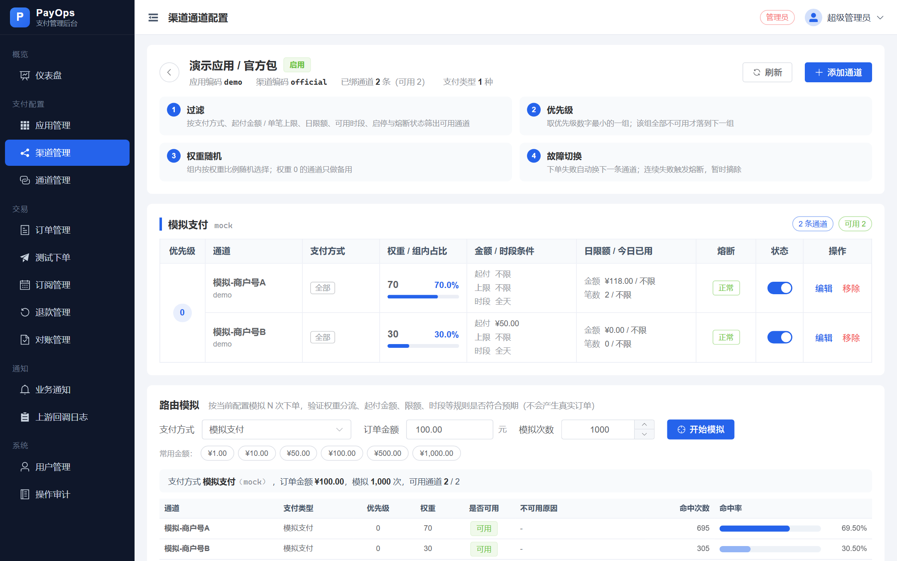

# PayOps

自用的分布式高可用支付系统：多应用 · 多渠道 · 多通道。项目主页与后台截图：<https://cn-cam.github.io/PayOps/>



- **支付类型**：微信支付、支付宝、抖音支付（APP / H5 / PC 扫码）、抖音小程序、华为 / OPPO / vivo / 小米 / 荣耀 应用商店支付、苹果应用内购买（另含联调用的模拟通道）
- **自动续费订阅**：华为 / 荣耀 / 苹果的首购、续订、退订、恢复、到期、撤销全链路，每期扣款生成独立订单
- **对账**：每日自动下载微信 / 支付宝 / 抖音支付账单，与本地逐笔勾对，差异留痕处理
- **按渠道配置通道**：一个渠道可绑定多个通道，同类型通道支持权重、优先级、起付金额、单笔上限、日限额、可用时段，自动故障转移与熔断
- **原生多副本**：网关、管理后台、后台任务均无状态，无需选主，可任意水平扩缩
- **技术栈**：.NET 10（ASP.NET Core）· Vue 3 + Element Plus · MySQL · Redis · RabbitMQ
- **部署**：单体 / Docker Compose / Kubernetes，同一份代码、同一个镜像

```text
应用 App ─1:N─> 渠道 Channel ─绑定(路由规则)─> 通道 Passage ─N:1─> 支付类型 Provider
（自有产品）    （官方包/华为/App Store…）    （一套自有凭证，如"微信-商户号A"）
```

## 快速开始

需要 .NET SDK 10+、Node 20+，以及 MySQL / Redis / RabbitMQ。把 `src/PayOps.Server/appsettings.Local.example.json` 复制为 `appsettings.Local.json`（不入库）并填写本机中间件账号。

```powershell
dotnet run --project src/PayOps.Server      # 后端 http://localhost:5080，首次启动自动建库建表
cd web/admin; npm install; npm run dev      # 管理后台 http://localhost:5175
pwsh scripts/demo.ps1                       # 端到端演示：路由/权重/起付金额/故障转移/回调/通知/退款/订阅/对账
dotnet test tests/PayOps.Tests              # 单元测试
```

后台默认账号 `admin` / `Admin@123456`（首次登录后请修改）。

## 文档

| 文档 | 内容 |
| --- | --- |
| [docs/01-总体设计.md](docs/01-总体设计.md) | 需求理解（自用多渠道多通道）、路由算法、架构、多副本与高可用机制、核心流程 |
| [docs/02-数据库设计.md](docs/02-数据库设计.md) | 库表、索引、状态机 |
| [docs/03-业务接入API.md](docs/03-业务接入API.md) | 下单 / 查询 / 关单 / 退款 / 凭证核验、签名、业务通知 |
| [docs/04-管理后台API.md](docs/04-管理后台API.md) | 管理端 API 契约 |
| [docs/05-部署手册.md](docs/05-部署手册.md) | 单体 / Compose / K8s、配置项、上线检查清单 |
| [docs/06-通道接入指南.md](docs/06-通道接入指南.md) | 各支付类型的凭证、回调配置、客户端配合点、验证状态 |
| [.opencode/skills/payops-dev](.opencode/skills/payops-dev/SKILL.md) | 开发技能：约定、配方、新增支付类型、部署与排障 |

## 目录

```text
src/PayOps.Core        领域模型、支付类型契约、路由算法、签名与加密
src/PayOps.Providers   各支付类型协议实现
src/PayOps.Service     数据访问、交易服务、后台任务、管理端服务
src/PayOps.Server      ASP.NET Core 宿主（接入 API / 上游回调 / 管理 API）
tests/PayOps.Tests     单元测试
web/admin              Vue3 管理后台
deploy                 standalone / docker / compose / k8s
scripts/demo.ps1       端到端演示与冒烟测试
scripts/screenshots.mjs  生成项目主页用的后台截图（无头浏览器）
docs/index.html        GitHub Pages 项目主页
```

## 重要说明

各真实支付类型按官方文档实现并有验签单元测试，但未使用真实商户凭证联调。上线前请按 [docs/05-部署手册.md](docs/05-部署手册.md) 的检查清单逐个通道验证。
